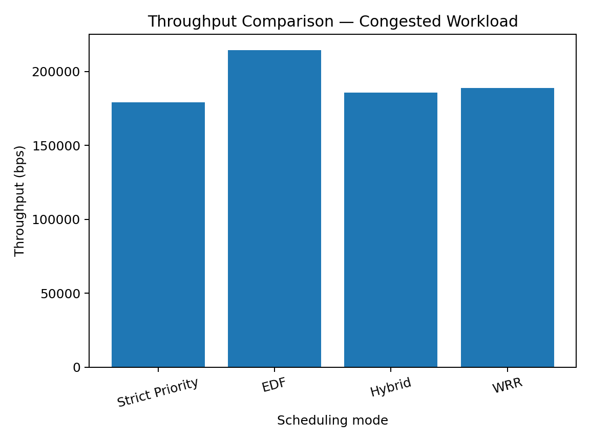
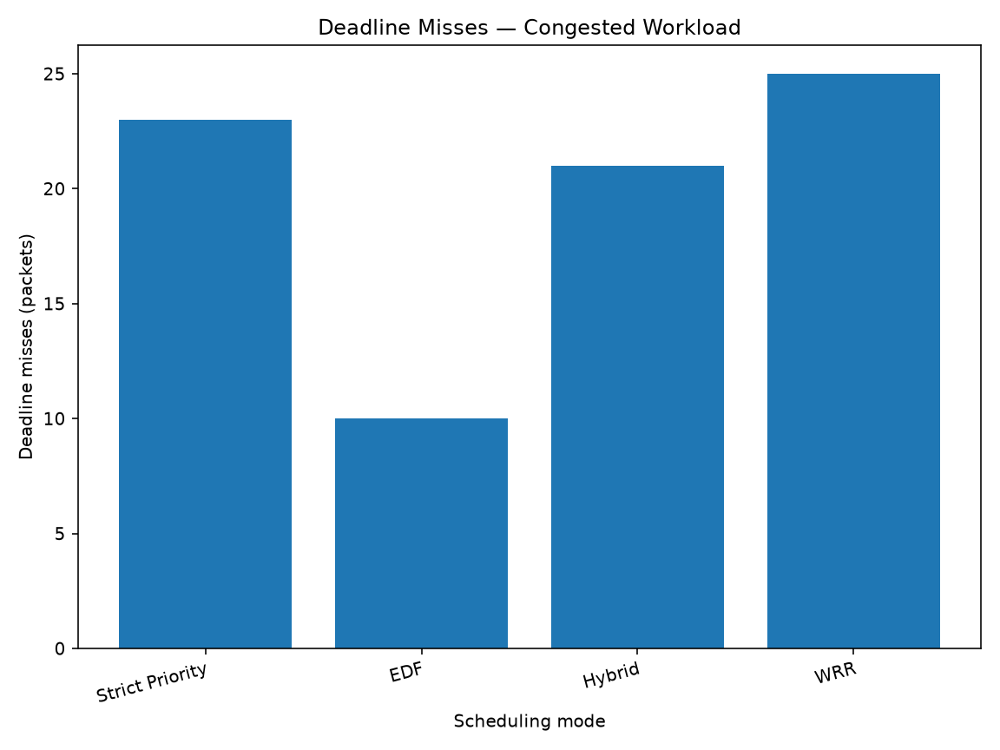
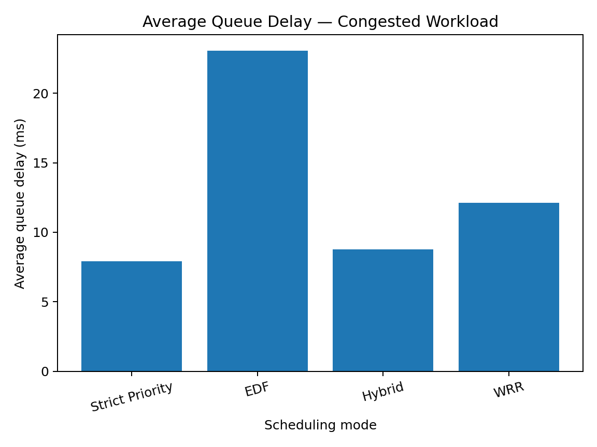
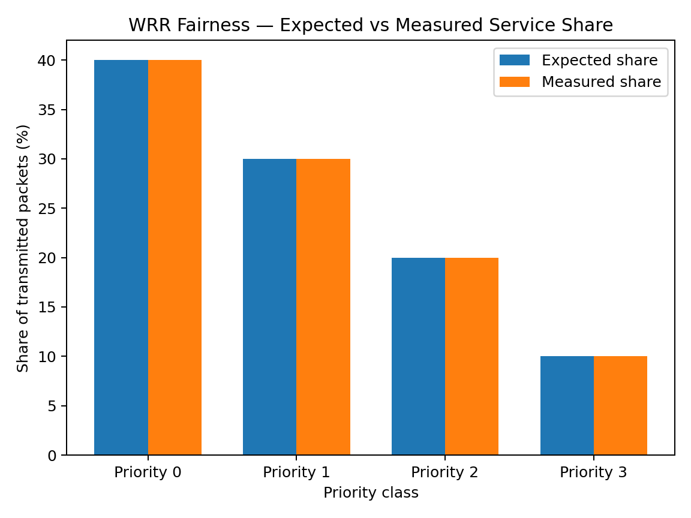

# FutureNet QoS — M05

**Deadline/Priority-Aware Queueing for ns-3.46.1**

## Overview

**FutureNet QoS** is a custom ns-3 module that implements priority-aware packet scheduling and deadline-aware queue management. It provides configurable scheduling policies, packet metadata, deadline-miss handling, queue-limit enforcement, tracing, and a configurable example program for evaluating QoS behavior under different traffic conditions.

---

## Features

- Priority-aware scheduling (priorities **0–7**, where **0** is highest)
- Four scheduling modes:
  - **0** – Strict Priority
  - **1** – Earliest Deadline First (EDF)
  - **2** – Hybrid (Strict Priority between classes + EDF within each class)
  - **3** – Weighted Round Robin (WRR)
- Deadline-miss detection
- Configurable expired-packet policy (Drop or Transmit)
- Global queue-limit enforcement
- Packet metadata using custom tags
- Queue tracing for:
  - Deadline misses
  - Expired packet drops
  - Dequeue events with queue delay
- Comprehensive unit tests

---

## Requirements

- ns-3.46.1
- C++ compiler supported by ns-3
- CMake
- Standard ns-3 build tools

---

## Project Structure

```
contrib/futurenet-qos/
├── CMakeLists.txt
├── README.md
├── model/
├── helper/
├── examples/
├── test/
├── doc/
│   └── FutureNet-QoS-Project-Report.md
└── results/
    ├── *.csv
    └── graphs/
```

---

## Build

From the **ns-3.46.1** root directory:

```bash
./ns3 configure
./ns3 build
```

---

## Running the Example

### Strict Priority

```bash
./ns3 run "futurenet-qos-example --schedulingMode=0"
```

### EDF

```bash
./ns3 run "futurenet-qos-example --schedulingMode=1"
```

### Hybrid

```bash
./ns3 run "futurenet-qos-example --schedulingMode=2"
```

### WRR

```bash
./ns3 run "futurenet-qos-example --schedulingMode=3"
```

### Example Parameters

| Option | Description |
|---------|-------------|
| `--maxPriority` | Maximum generated priority; priorities range from `0` to this value (default `4`, maximum `7`) |
| `--noDeadlinePercent` | Approximate percentage of generated packets without a deadline (default `0`, range `0`–`100`) |
| `--deadlineMode` | `high` uses the original 10–50 ms deadlines (default); `medium` uses 40–200 ms; `custom` uses the configured custom range |
| `--customMinDeadlineMs` | Custom-mode minimum deadline in milliseconds (default `1`, range `1`–`60000`) |
| `--customMaxDeadlineMs` | Custom-mode maximum deadline in milliseconds (default `60000`, maximum `60000`) |
| `--queueLimit` | Maximum queue capacity |
| `--arrivalIntervalMs` | Packet arrival interval |
| `--serviceIntervalMs` | Packet service interval |
| `--durationMs` | Experiment duration |
| `--packetCount` | Number of packets generated |
| `--expiredPolicy` | `0=Drop`, `1=Transmit` |
| `--csvFile` | Output CSV filename |
| `--fairnessTest` | Enable controlled WRR fairness experiment |

Display all available options:

```bash
./ns3 run "futurenet-qos-example --PrintHelp"
```

For example, to generate approximately 25% of packets without deadlines:

```bash
./ns3 run "futurenet-qos-example --noDeadlinePercent=25"
```

For example, generate priorities from 0 through 7 with:

```bash
./ns3 run "futurenet-qos-example --maxPriority=7"
```

Select the medium deadline range with:

```bash
./ns3 run "futurenet-qos-example --deadlineMode=medium"
```

Custom mode spreads deadlines across the configured minimum and maximum:

```bash
./ns3 run "futurenet-qos-example --deadlineMode=custom --customMinDeadlineMs=100 --customMaxDeadlineMs=5000"
```

---

## Running Tests

Run the FutureNet QoS test suite:

```bash
./test.py -s futurenet-queue-disc
```

Individual tests:

```bash
./ns3 run "test-runner --suite=futurenet-traffic-tag --verbose"
./ns3 run "test-runner --suite=futurenet-deadline-tag --verbose"
./ns3 run "test-runner --suite=futurenet-queue-disc --verbose"
```

All FutureNet QoS tests pass successfully.

---

## Experimental Results

### Congested Workload (1 ms arrival / 2 ms service)

| Mode | Throughput (bps) | Deadline Misses |
|------|-----------------:|----------------:|
| Strict Priority | 179,200 | 23 |
| EDF | **214,400** | **10** |
| Hybrid | 185,600 | 21 |
| WRR | 188,800 | 25 |

**Observations**

- EDF achieved the highest throughput.
- EDF recorded the fewest deadline misses.
- Strict Priority provided the lowest queue delay.
- WRR demonstrated weighted service allocation.

### WRR Fairness Validation

Configured weights: **4 : 3 : 2 : 1**

Measured transmissions:

| Priority | Packets |
|---------:|--------:|
| 0 | 1999 |
| 1 | 1501 |
| 2 | 1000 |
| 3 | 500 |

The measured distribution closely matches the configured WRR weights.

---

## Performance Graphs

### Throughput Comparison



### Deadline Misses



### Average Queue Delay



### WRR Fairness



---

## Documentation

The complete project report is available at:

- **Project Report:** `doc/FutureNet-QoS-Project-Report.md`

The repository also includes measured CSV files inside `results/`.

---

## Project Objective

FutureNet QoS (M05) investigates how packet priority and transmission deadlines influence queue scheduling, deadline handling, fairness, and quality of service within the ns-3.46.1 network simulator.

---

## Repository

GitHub:

`https://github.com/karthikeyagiramoni/futurenet-qos`